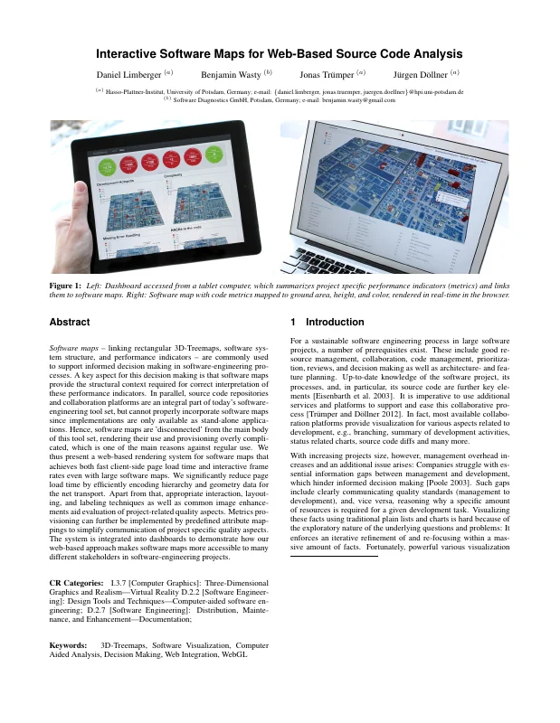
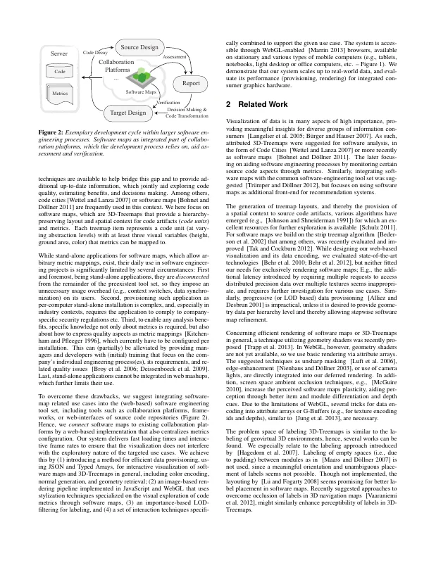
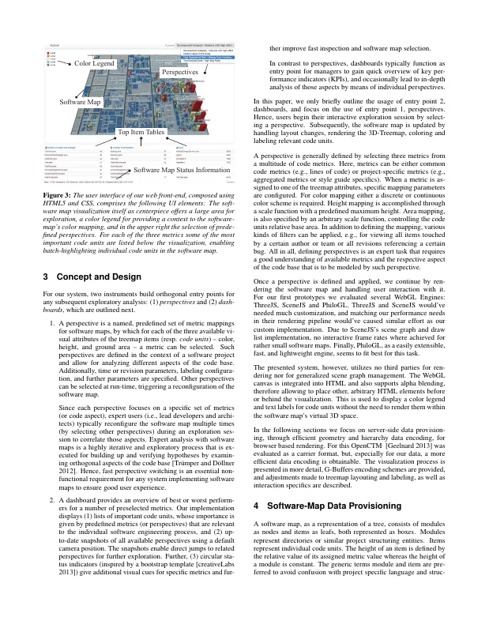
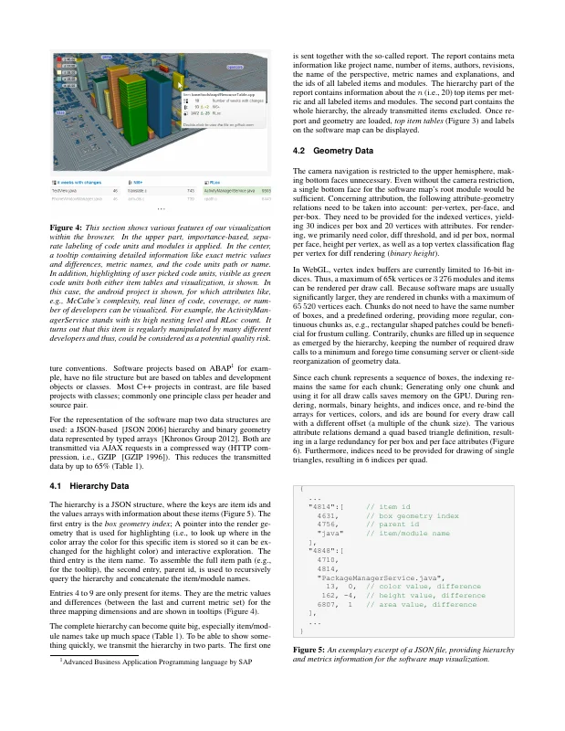
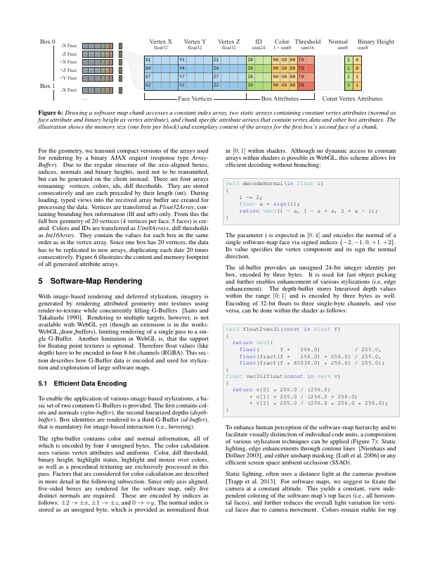
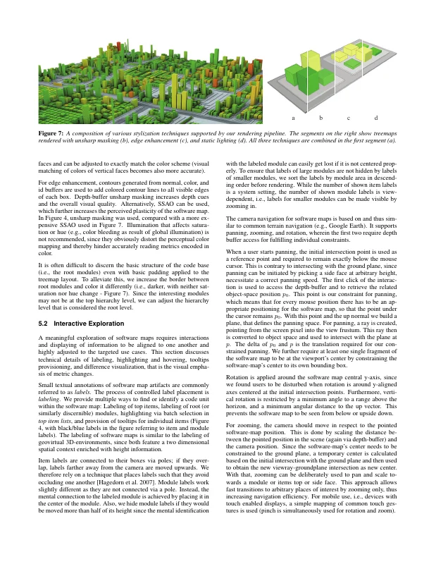
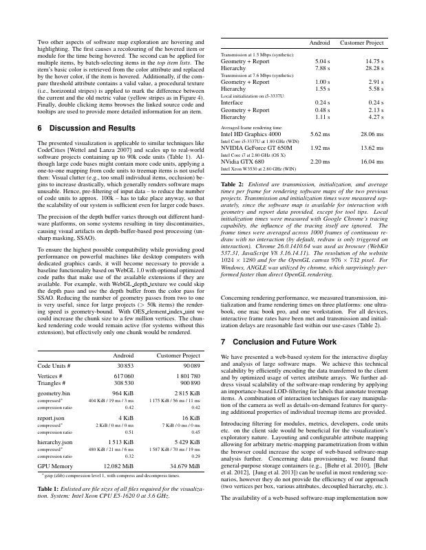
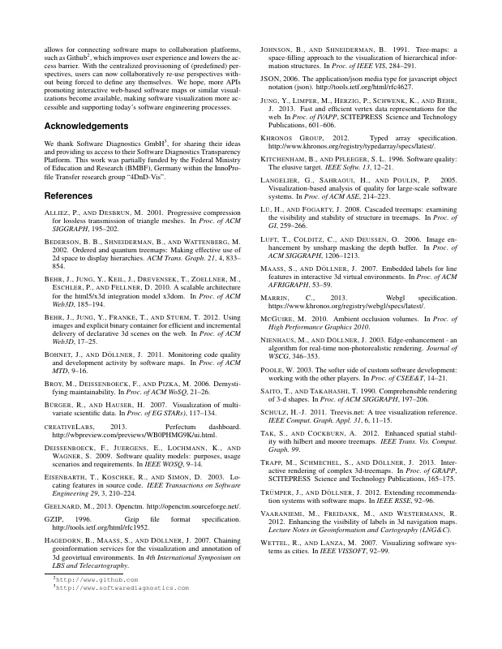

# Interactive Software Maps for Web-Based Source Code Analysis

[Daniel Limberger](https://orcid.org/0000-0002-9111-4809), Benjamin Wasty, Jonas Trümper, and [Jürgen Döllner](https://orcid.org/0000-0002-8981-8583)

*Proceedings of the 18th International Conference on 3D Web Technology (Web3D '13)*, June 20–22, 2013, San Sebastian, Spain. ACM, pp. 91–98.

[](https://doi.org/10.1145/2466533.2466550) [](https://www.researchgate.net/publication/262408378)

Video: [YouTube](https://www.youtube.com/watch?v=AaHJRVQ3Z1E)

> Software maps – linking rectangular 3D-Treemaps, software system structure, and performance indicators – are commonly used to support informed decision making in software-engineering processes.
> A key aspect for this decision making is that software maps provide the structural context required for correct interpretation of these performance indicators.
> In parallel, source code repositories and collaboration platforms are an integral part of today's software-engineering tool set, but cannot properly incorporate software maps since implementations are only available as stand-alone applications.
> Hence, software maps are 'disconnected' from the main body of this tool set, rendering their use and provisioning overly complicated, which is one of the main reasons against regular use.
> We thus present a web-based rendering system for software maps that achieves both fast client-side page load time and interactive frame rates even with large software maps.
> We significantly reduce page load time by efficiently encoding hierarchy and geometry data for the net transport.
> Apart from that, appropriate interaction, layouting, and labeling techniques as well as common image enhancements aid evaluation of project-related quality aspects.
> Metrics provisioning can further be implemented by predefined attribute mappings to simplify communication of project specific quality aspects.
> The system is integrated into dashboards to demonstrate how our web-based approach makes software maps more accessible to many different stakeholders in software-engineering projects.

<p><a href="limberger2013-interactive-as-submitted.pdf"></a> <a href="limberger2013-interactive-as-submitted.pdf"></a> <a href="limberger2013-interactive-as-submitted.pdf"></a> <a href="limberger2013-interactive-as-submitted.pdf"></a></p>
<details><summary>Remaining 4 pages</summary><p><a href="limberger2013-interactive-as-submitted.pdf"></a> <a href="limberger2013-interactive-as-submitted.pdf"></a> <a href="limberger2013-interactive-as-submitted.pdf"></a> <a href="limberger2013-interactive-as-submitted.pdf"></a></p></details>

## Contents

- [`src/`](src/) – LaTeX sources of the camera-ready version (ACM SIGGRAPH template `acmsiggraph.cls`/`.bst` of 2013, bundled)
- [`limberger2013-interactive-as-submitted.pdf`](limberger2013-interactive-as-submitted.pdf) – camera-ready PDF as submitted to ACM (2013-05-03)
- [`build.sh`](build.sh) – reproducible build with TeX Live 2013 (podman or docker)
- [`preview/`](preview/) – page previews for this README

## Build

```bash
./build.sh          # → build/web3d-webbased-treemaps.pdf
./build.sh author   # → build/web3d-webbased-treemaps-author.pdf (ACM author's version notice and DOI in the bottom margin)
```

The original was compiled with MiKTeX 2.9 (pdfTeX 1.40.13, 2013); the build uses the oldest available TeX Live container, TeX Live 2013 (pdfTeX 1.40.14).
The build matches `limberger2013-interactive-as-submitted.pdf` pixel for pixel (all 8 pages, compared at 150 dpi).
The 2013 ACM SIGGRAPH template has no author-version option, so `./build.sh author` adds the notice on every page without touching the sources or the layout.

## Versions

- [`v1.0-camera-ready`](https://github.com/dl-archive/article.2013-web3d-web-based-swmaps/tree/v1.0-camera-ready) – sources as submitted to ACM (2013-05-03)

## Citation

```bibtex
@InProceedings{limberger2013-interactive,
  author    = {Limberger, Daniel and Wasty, Benjamin and Tr{\"u}mper, Jonas and D{\"o}llner, J{\"u}rgen},
  title     = {Interactive Software Maps for Web-based Source Code Analysis},
  booktitle = {Proceedings of the 18th International Conference on 3D Web Technology},
  year      = {2013},
  series    = {Web3D~'13},
  publisher = {ACM},
  pages     = {91--98},
  doi       = {10.1145/2466533.2466550},
  isbn      = {978-1-450321-33-4},
}
```
